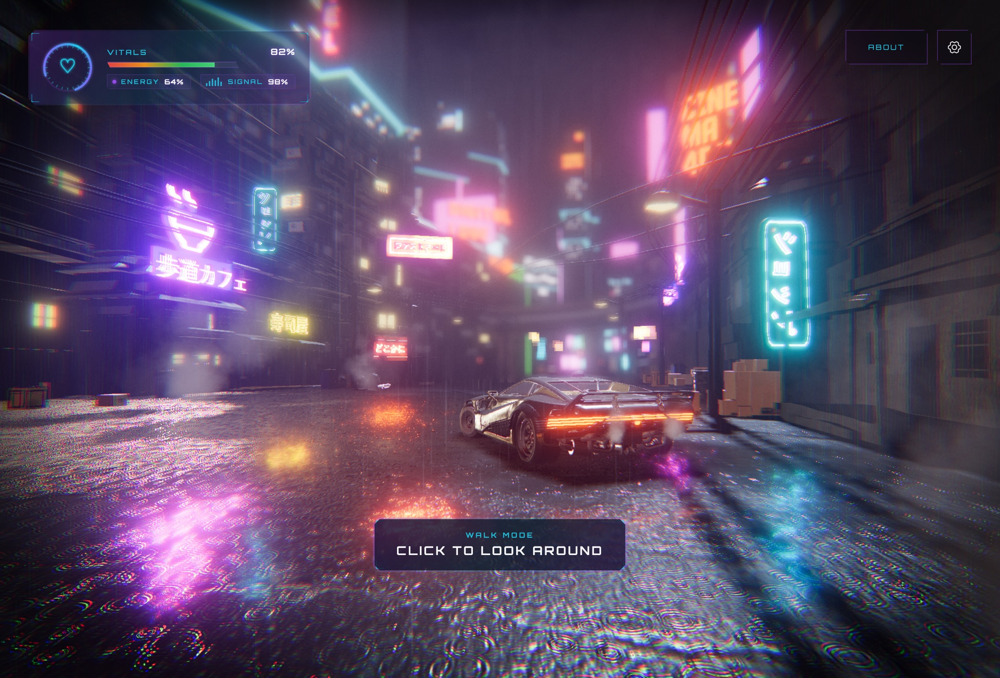

# threejs-punk-adam

[](https://github.com/olekariamunyororo-crypto/threejs-punk-adam/actions/workflows/ci.yml)



**Live demo:** [https://threejs-punk-adam.vercel.app](https://threejs-punk-adam.vercel.app)

**First-person combat fork** of [Threejs-Punk](https://github.com/ektogamat/threejs-conference) / [threejspunk.vercel.app](https://threejspunk.vercel.app/) — a rainy cyberpunk alley on **WebGPU + Three.js + TSL**, extended with **Adam Smasher NPCs**, **player shooting**, and an optional **hovercar**.

| | |
|---|---|
| **Live demo** | [https://threejs-punk-adam.vercel.app](https://threejs-punk-adam.vercel.app) |
| **Base scene** | Anderson Mancini · Sunag (TSL) — [TSL Workshop 2026](https://threejs.paris/) |
| **This fork** | FPS layer: enemies, combat, vehicles (`olekariamunyororo-crypto/threejs-punk-adam`) |
| **Stack** | Three.js `^0.185` (WebGPU + TSL), Vite 6, `three-mesh-bvh`, GSAP |
| **Branch** | `main` |

If this README disagrees with the code, **the code wins**. Agents: also read **[AGENTS.md](AGENTS.md)** and **[src/ai/README.md](src/ai/README.md)**.

---

## Quick start

**Needs:** a **WebGPU** browser and Node.js.

```bash
git clone https://github.com/olekariamunyororo-crypto/threejs-punk-adam.git
cd threejs-punk-adam
npm install
npm run dev      # HTTPS via @vitejs/plugin-basic-ssl (WebGPU requires a secure context)
```

| Script | Action |
|--------|--------|
| `npm run dev` | Vite dev server |
| `npm run build` | Production build |
| `npm run preview` | Preview build |
| `npm run deploy` | Vercel production |

1. Wait for the loader.
2. **ENTER** on the intro (unless `FEATURES.intro` is false).
3. Walk / look; fire with the viewmodel controls.
4. Expect **Adam Smasher** near the Quadra; a second agent spawns a few seconds later.

---

## What this fork adds (game layer)

### Player combat
- First-person **viewmodel** (arms + rifle) — `src/world/viewmodel/`
- Health / hit / respawn — `src/game/playerCombat.js`
- Gun audio via **Web Audio** (`fetch` + `decodeAudioData`) from `public/sounds/` — `src/world/viewmodel/createGunAudio.js`
- Procedural fallback if the sample is missing

### Enemy NPCs (Adam Smasher)
- Model: `public/models/adam_smasher_rigged.glb` (~10 MB, rigged)
- **Two agents** via `setupEnemyPair` (not the experimental 6-NPC squad):
  - **Agent 0** — next to the Quadra (immediate)
  - **Agent 1** — flank spawn (~4 s later, separate load)
- AI brain: **patrol → chase → attack** (no RL package required)
- Animation cross-fade when Idle / Walk / Run / Attack / Die clips exist
- Feet snapped to ground; red capsule fallback while loading
- Enemy pistol, tracers, hit chance, player damage
- Player bullets vs bone capsules; one-shot kill + delayed respawn
- Optional **IgnitionAI** hooks (`EnemyTrainingEnv`) — off by default (`autoTrain: false`)

| File | Role |
|------|------|
| `src/ai/setupEnemyPair.js` | Safe dual spawn (used by `main.js`) |
| `src/ai/setupEnemyAI.js` | Single agent: GLB, brain, anims, combat attach |
| `src/ai/EnemyTrainingEnv.js` | BVH-aware observe / step / reward (IgnitionAI-shaped) |
| `src/ai/enemyCombat.js` | Pistol, tracers, bone hit tests |
| `src/ai/setupEnemySquad.js` | Experimental multi-clone path (**not wired** — caused black screens on mobile) |

### Hovercar (optional)
- Flag: `FEATURES.hovercar`
- Enter / drive / fly — `src/game/hovercar.js`, `hovercarPhysics.js`
- Asset: `public/models/hovercar.glb`

### Phase-1 walk mode
- `FEATURES.gameWalk` — walk-first FPS feel (crosshair-oriented flow)

---

## Feature flags

Edit [`src/world/features.js`](src/world/features.js):

```js
export const FEATURES = {
  city: true,
  car: true,
  rain: true,
  smoke: true,
  planes: true,
  sky: true,
  ground: true,
  intro: true,
  chromeUi: true,
  walkUi: true,
  audio: true,
  inspector: true,
  gameWalk: true,      // FPS-oriented walk
  trainEnemies: true,  // Adam Smasher pair
  hovercar: true,      // Enterable hovercar
};
```

Turn `trainEnemies` off if you only want the original alley demo.

---

## Assets (`public/`)

### Models (`public/models/`)

| File | Approx. size | Use |
|------|--------------|-----|
| `cyberpunk_compressed.glb` | ~4.5 MB | City |
| `colider.glb` | small | Invisible walk bounds |
| `quadra.glb` | ~2.6 MB | Street car |
| `plane.glb` | ~2.4 MB | Flying planes |
| `billboards.glb` | small | Neon boards |
| `vsk.glb` | ~5.3 MB | Player viewmodel weapon |
| `adam_smasher_rigged.glb` | ~10 MB | Enemy NPC |
| `hovercar.glb` | ~3.0 MB | Driveable hovercar |

> Keep large `.glb` files under GitHub’s **100 MB** limit. Prefer Git LFS for future huge assets.

### Sounds

| Path | Use |
|------|-----|
| `public/sounds/Ak-74.mp3` | Player shot sample (case-sensitive on Linux) |
| `public/sounds/ak74-shot.mp3` | Tiny fallback sample |
| `public/engine.mp3`, rain / ambience tracks | World audio |

**Gun audio note:** code tries `/sounds/ak-74.mp3` and `/sounds/ak74-shot.mp3`. On case-sensitive filesystems, rename or symlink so the path matches, e.g.:

```bash
cd public/sounds
ln -sf Ak-74.mp3 ak-74.mp3   # if only Ak-74.mp3 exists
```

Console success line: `[GunAudio] loaded /sounds/...`

### Other

- HDRIs under `public/hdri/`
- Wet ground textures under `public/textures/`
- Draco / Basis under `public/libs/`

---

## Architecture (fork-aware)

Still a **factory composition** in [`src/main.js`](src/main.js) — no ECS.

### Startup order

1. Device budgets + layout  
2. Camera, scene, WebGPU renderer  
3. World (parallel GLTF loads) + viewmodel  
4. Lighting, env map, post pipeline  
5. Camera director (orbit / walk)  
6. **Enemy pair** (non-blocking; agent 1 delayed)  
7. App shell, audio, intro  
8. Shader warmup → render loop  

Enemies **must not** `await` during init (that caused black screens when a 6-NPC squad blocked on a 10 MB GLB).

### Folder map

```
src/
├── main.js                 Wire-up root
├── ai/                     Enemy NPC + combat + optional RL env
├── game/                   Player combat, hovercar, vehicle state
├── bootstrap/              WebGPU renderer, camera
├── app/                    Loader, shell, intro flow
├── intro/                  Rain-glass intro
├── runtime/                Loop, camera director, warmup
├── controls/               BVH first-person walk
├── world/                  City, car, ground, weather, viewmodel
├── clouds/                 Procedural sky
├── post/                   TSL pipeline + look presets
├── tsl/                    Rain, blur, chromatic aberration, ripples
├── platform/               DPR, device, performance, prefs
├── ui/                     Chrome, walk HUD, joystick
├── audio/                  Spatial engines, footsteps
└── debug/                  Inspector, perf, dev API
```

### One frame (simplified)

```
loop tick
  → cameraDirector.update
  → world systems (rain, sky, car, smoke…)
  → viewmodel.update (if walk + alive)
  → enemyAI.update (pair of agents)
  → post.render
  → adaptive DPR sample
```

---

## Base scene techniques (unchanged)

The original alley still uses:

- **GPU collision rain** (height RT + compute) — [docs/techniques/collision-rain.md](docs/techniques/collision-rain.md)
- **Wet ground** (ripples + planar reflection) — [docs/techniques/wet-ground.md](docs/techniques/wet-ground.md)
- **Car surface rain** (TSL droplets) — [docs/techniques/car-surface-rain.md](docs/techniques/car-surface-rain.md)
- **BVH walk** — `src/controls/createWalkControls.js` + `src/world/bvh.js`
- **Post** — GTAO, bloom, DoF, cyberpunk grade, SMAA — `src/post/`

Deep teaching notes and strip order: **[STRIP.md](STRIP.md)**, **[AGENTS.md](AGENTS.md)**.

---

## Performance notes

| Topic | Guidance |
|-------|----------|
| **NPC count** | **2** is the stable default. 6× skinned clones froze mobile / WebGPU init. |
| **Spawn** | Never block `init` on GLB load; delay extra agents. |
| **SkeletonUtils** | Valid for multi-instance skinned meshes, but heavy + sensitive under WebGPU — avoided in the pair path. |
| **Device policy** | Mobile trims lens flare, billboards, GTAO; Safari caps DPR — `performanceProfile.js` |
| **Adaptive DPR** | One-way FPS downgrade after intro |

---

## Troubleshooting

| Symptom | Check |
|---------|--------|
| Black screen / stuck loader | Disable `trainEnemies`; clear Vite cache: `rm -rf node_modules/.vite` |
| No Adam | `FEATURES.trainEnemies === true`; file at `public/models/adam_smasher_rigged.glb`; console `[EnemyPair]` / `[EnemyAI]` |
| Soft noise instead of AK | Sample path / case: `public/sounds/ak-74.mp3` or `Ak-74.mp3`; Network tab 200; console `[GunAudio] loaded …` |
| Floating enemy | Ground mesh must be `world.ground.mesh`; feet offset uses `pivotToFeet` in `setupEnemyAI` |
| Vite can’t resolve `ignitionai` | Package is **optional**; import is dynamic + `@vite-ignore`. Don’t install unless training. |

```bash
git pull origin main
rm -rf node_modules/.vite
npm run dev
```

---

## Credits

- **Original Threejs-Punk / conference demo** — [Anderson Mancini](https://andersonmancini.dev/), **Sunag** (TSL), workshop contributors  
- **Fork gameplay** — Adam Smasher NPC, dual spawn, combat, hovercar, gun sample wiring  
- Rain surface math lineage — [rocksdanister/rain](https://github.com/rocksdanister/rain) (credited in source)

---

## License

See [LICENSE](LICENSE). Respect licenses of third-party models, audio, and textures when redistributing.
